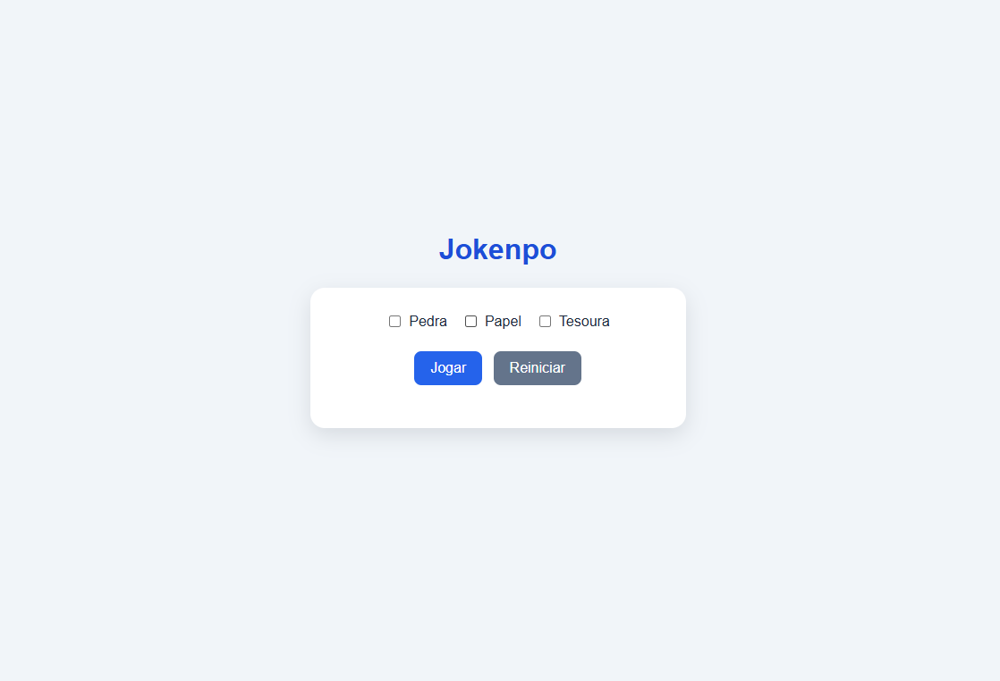
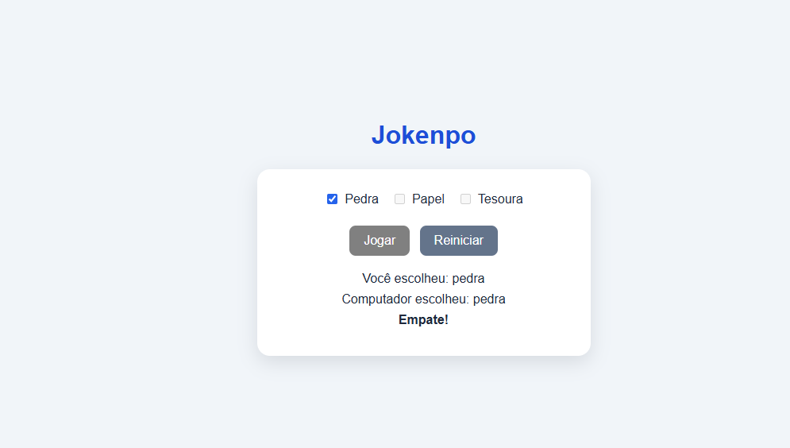
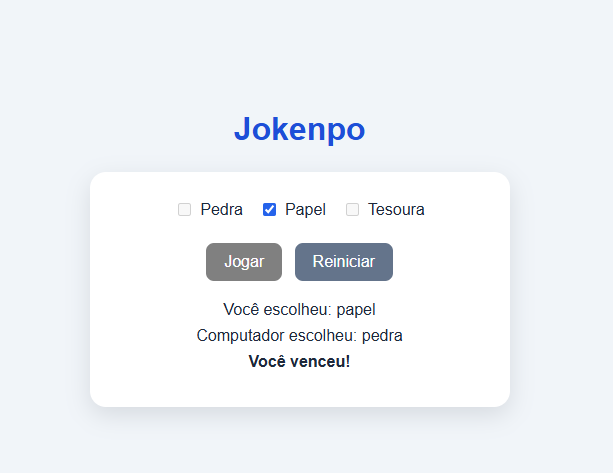

# Jokenpo

Um jogo de pedra, papel e tesoura para jogar no navegador. Escolha uma jogada, dispute contra o computador e veja o resultado da rodada.

## Como jogar

1. Abra o arquivo `index.html` em um navegador moderno.
2. Selecione **Pedra**, **Papel** ou **Tesoura**.
3. Clique em **Jogar** para ver a escolha aleatória do computador e o resultado.
4. Clique em **Reiniciar** para limpar a rodada e jogar novamente.

É necessário selecionar uma jogada antes de clicar em **Jogar**. As regras são as tradicionais: pedra vence tesoura, tesoura vence papel e papel vence pedra. Jogadas iguais empatam.

## Tecnologias

- HTML
- CSS
- JavaScript (ES modules)

O projeto não precisa de instalação de dependências ou processo de build.

## Capturas de tela

### Tela inicial



### Resultado de empate



### Resultado de vitória



## Estrutura do projeto

```text
.
├── index.html
└── src/
    ├── script.js
    └── style.css
```

- `index.html`: estrutura da página e controles do jogo.
- `src/style.css`: estilos e layout.
- `src/script.js`: seleção de jogadas, regras, resultado e reinício da partida.
